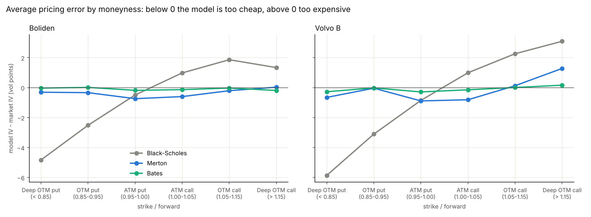

# Fair value of Swedish equity options: Black-Scholes, Merton and Bates

Student project with SEB's equity-derivatives desk (2025-2026). SEB's question:

> Can jump risk improve the pricing of the parts of the option market where Black-Scholes deviates most from market prices?

We price every Boliden (BOL) and Volvo B (VOLVB) option quote from 2 May to 30 Dec 2025 (167 trading days) with three models,
compare the model prices with the market, and test which model still prices well on later days.

## Contents

1. [Repository layout](#repository-layout)
2. [How we measure the market price](#how-we-measure-the-market-price)
3. [The three models](#the-three-models)
4. [Results](#results)
5. [How to run](#how-to-run)
6. [Files](#files)

## Repository layout

```
data/BOL.csv, data/VOLVB.csv    daily closing bid/ask quotes (stock + options)
        |
fair_value.py                    CORE: fair value of every option under Black-Scholes, Merton and Bates
        |                        -> csv/detail/fair_values_*.csv, parameters_*.csv; csv/summary/: tables; results/: 3 charts
        |-- moneyness.py         ANALYSIS: how each model does in the 6 moneyness buckets (deep OTM put ... deep OTM call)
        |                        -> csv/summary/summary_by_moneyness.csv, csv/detail/moneyness_options_*.csv; results/: 2 charts
out_of_sample.py                 TEST: today's parameters on the quotes 1-40 trading days later, Merton vs Bates
                                 -> csv/summary/out_of_sample*.csv; results/: 1 chart
```

The `csv/` folder is split in two: `csv/summary/` holds the small tables quoted in this README, `csv/detail/` holds the
large per-option and per-day data they are computed from.

## How we measure the market price

Only closing **bid** and **ask** quotes exist (no trade prices), so the market price is the **mid**:

$$
P^{\mathrm{mid}} = \frac{\mathrm{bid} + \mathrm{ask}}{2}
$$

The true price can be anywhere between bid and ask, so a model price $P^{\mathrm{model}}$ is judged against the spread, not the
mid alone. The error is measured in **half-spreads**:

$$
z = \frac{P^{\mathrm{model}} - P^{\mathrm{mid}}}{(\mathrm{ask} - \mathrm{bid})/2}
$$

with the half-spread set to at least 0.05 SEK. $\lvert z \rvert \le 1$ means the model price is **inside bid/ask**. Fitting on $z$
also gives tightly quoted options more weight.

- Quotes used: out-of-the-money options only (puts with strike below the forward, calls above), bid above 0.01 SEK,
  at least 5 days to expiry, spread no larger than the mid. About 12,000 quotes per stock.
- Inputs: stock price $S$ = mid of the stock's bid/ask, interest rate $r = 2\,\%$, no dividend (none in the period). The
  options are American, but without dividends the early-exercise value of out-of-the-money options is below the spread, so
  European pricing is used.
- Moneyness is measured against the forward $F = S\,e^{rT}$, as $K/F$ or as log-moneyness $k = \ln(K/F)$.

## The three models

All three describe the stock price $S_t$ under the risk-neutral measure with interest rate $r$ and no dividend.

**Black-Scholes** has constant volatility $\sigma$ (here one $\sigma$ per expiry, the baseline):

$$
\frac{dS_t}{S_t} = r\,dt + \sigma\,dW_t
$$

**Merton (1976)** adds jumps that arrive at random. The number of jumps $N_t$ is Poisson with rate $\lambda$ per year, and each
jump multiplies the price by $e^{J}$ with $J \sim \mathcal{N}(\mu_J,\ \sigma_J^2)$:

$$
\frac{dS_t}{S_t} = (r - \lambda m)\,dt + \sigma\,dW_t + \left(e^{J} - 1\right) dN_t, \qquad m = e^{\mu_J + \sigma_J^2/2} - 1
$$

The drift correction $\lambda m$ keeps the forward price unchanged, so jumps change the shape of the smile but not the average
price level.

**Bates (1996)** lets the variance $v_t$ move randomly and mean-revert (Heston), and adds the same jumps:

$$
\frac{dS_t}{S_t} = (r - \lambda m)\,dt + \sqrt{v_t}\,dW^S_t + \left(e^{J} - 1\right) dN_t
$$

$$
dv_t = \kappa\,(\theta - v_t)\,dt + \xi \sqrt{v_t}\,dW^v_t, \qquad dW^S_t\, dW^v_t = \rho\,dt
$$

| Model | Parameters per day |
|---|---|
| Black-Scholes | about 4.6 (one volatility per expiry) |
| Merton | 4: $\sigma$, $\lambda$, $\mu_J$, $\sigma_J$ |
| Bates | 8: $v_0$, $\kappa$, $\theta$, $\xi$, $\rho$, $\lambda$, $\mu_J$, $\sigma_J$ |

**Pricing.** Merton and Bates are priced with the COS method (Fang & Oosterlee 2008), which turns the model's
characteristic function into option prices. For $X = \ln(S_T/F_T)$ the Merton characteristic function is

$$
\ln \mathbb{E}\!\left[e^{iuX}\right] = -\tfrac{1}{2}\sigma^2 T\,(iu + u^2) + \lambda T \left( e^{\,iu\mu_J - \frac{1}{2}\sigma_J^2 u^2} - 1 - iu\,m \right)
$$

and Bates replaces the first term by the Heston one and keeps the jump term.

**Fitting.** Each model is fitted separately to each day's options (all expiries at once) by least squares on $z$:

$$
\hat\theta_{\text{day}} = \arg\min_{\theta} \sum_{\text{options}} z_i(\theta)^2
$$

## Results

### 1. Fit: share of options priced inside bid/ask

Source: `csv/summary/summary.csv`, all 167 days.

| | Black-Scholes | Merton | Bates |
|---|---|---|---|
| Boliden | 55 % | 86 % | 97 % |
| Volvo B | 24 % | 69 % | 86 % |
| Boliden, RMSE in half-spreads | 1.09 | 0.78 | 0.45 |
| Volvo B, RMSE in half-spreads | 2.05 | 1.27 | 0.70 |


**By moneyness** (`moneyness.py`, `csv/summary/summary_by_moneyness.csv`). Options are grouped by strike / forward price
(forward = stock price grown at the 2 % rate until expiry). Only out-of-the-money options are used: puts below the forward,
calls above. An in-the-money option carries the same information as the out-of-the-money option with the same strike,
by put-call parity:

$$
C - P = S - K e^{-rT}
$$

| Bucket | Strike / forward | BS Boliden | Merton Boliden | Bates Boliden | BS Volvo B | Merton Volvo B | Bates Volvo B |
|---|---|---|---|---|---|---|---|
| Deep OTM put | below 0.85 | 11 % | 99 % | 100 % | 0 % | 85 % | 96 % |
| OTM put | 0.85-0.95 | 44 % | 91 % | 97 % | 6 % | 79 % | 87 % |
| ATM put | 0.95-1.00 | 99 % | 82 % | 97 % | 73 % | 66 % | 79 % |
| ATM call | 1.00-1.05 | 93 % | 79 % | 95 % | 60 % | 58 % | 77 % |
| OTM call | 1.05-1.15 | 50 % | 79 % | 96 % | 8 % | 58 % | 84 % |
| Deep OTM call | above 1.15 | 40 % | 84 % | 98 % | 1 % | 45 % | 98 % |

Black-Scholes prices the middle and misses both wings (puts too cheap, calls too expensive: the skew). Merton fixes the
crash wing but gives up some accuracy at the money. Bates fits wings and middle at the same time.


The average error shows the direction: Black-Scholes prices puts too cheaply (by 2.5-6 vol points) and calls too
expensively (1-3 vol points); Merton and Bates are within about 1 vol point everywhere, Bates within 0.3.



`python moneyness.py --option 280 250 90 put` classifies one option (stock price, strike, days to expiry, call or put):
forward 281.4, strike / forward 0.89, out of the money, bucket "OTM put". Each classified option is added to
`csv/detail/classified_options.csv`.

### 2. Why: the skew across maturities

Source: `csv/summary/skew_decay.csv`. The skew is the slope of implied volatility against log-moneyness,
$\partial \sigma_{\mathrm{imp}} / \partial k$ (how much more expensive downside protection is). It fades with maturity as

$$
\lvert \text{skew} \rvert \propto T^{\,b}
$$

where $b$ is estimated by regressing $\ln \lvert \text{skew} \rvert$ on $\ln T$. Black-Scholes has no skew at all. Merton's skew
fades much too fast, Bates matches the market.

| Exponent $b$ (95 % CI) | Market | Merton | Bates |
|---|---|---|---|
| Boliden | -0.36 [-0.39, -0.33] | -0.62 [-0.66, -0.58] | -0.43 [-0.45, -0.40] |
| Volvo B | -0.41 [-0.42, -0.39] | -0.70 [-0.74, -0.66] | -0.44 [-0.46, -0.43] |


**What the jumps look like** (`csv/summary/jump_sizes.csv`). The size of one jump implied by the option prices, averaged over
all days. Merton needs large crashes (median jump -17 % on Boliden, -14 % on Volvo B, about 90 % of jumps downward) to create
the skew. Bates needs only small drops (median -6 % and -4 %), because its moving variance, which tends to rise when the stock
falls, creates the rest of the skew. These are risk-neutral values: they include the price of crash insurance and are not a
forecast of real jumps. On their own, the number of jumps per year $\lambda$ and the jump size $\mu_J$ are poorly determined;
their combined effect (the jump share of variance, about 45 %) is.


### 3. Out of sample: is Bates just over-fitting?

Source: `csv/summary/out_of_sample.csv` and `out_of_sample_test.csv`. Parameters fitted on day $t$ price the quotes of day
$t + h$, which the fit never saw.

| Pricing error $h$ trading days later (RMSE in half-spreads), Merton / Bates | +1 | +5 | +10 | +20 | +40 |
|---|---|---|---|---|---|
| Boliden | 0.87 / 0.60 | 1.08 / 0.95 | 1.31 / 1.25 | 1.53 / 1.60 | 1.89 / 2.05 |
| Volvo B | 1.41 / 0.91 | 1.75 / 1.51 | 2.09 / 1.94 | 2.30 / 2.37 | 2.72 / 3.02 |

The models are compared with a Diebold-Mariano test. For each fit day $t$ the loss $L_t$ is the mean $z^2$ of the future
quotes, and the test asks whether

$$
d_t = \ln \frac{L_t^{\mathrm{Merton}}}{L_t^{\mathrm{Bates}}}
$$

is zero on average (Newey-West standard error, because neighbouring days overlap). Bates is significantly better than Merton
($p < 0.01$) up to 10 trading days ahead on both stocks; at 20 days there is no difference, and at 40 days Merton is better on
Boliden. After about 20 days every model is off by more than a half-spread, so in practice the parameters are re-fitted every
day.


### Conclusion

Jump risk (Merton) fixes most of what Black-Scholes misses, but Merton's skew fades too fast with maturity. Bates, which adds
randomly moving variance, prices 86-97 % of the options inside bid/ask, matches the market's skew across maturities, and
stays better than Merton for about two weeks out of sample.

## How to run

Python 3.10 or newer.

```
pip install -r requirements.txt
python fair_value.py        # about 10 minutes on a 6-core laptop (all days, both stocks)
python moneyness.py         # seconds, uses the fair values from fair_value.py
python out_of_sample.py     # about 1 minute, uses the parameters from fair_value.py
```

`python fair_value.py --max-days 3` is a quick test on the first three trading days; `python fair_value.py --report-only`
redoes only the tables and charts from the saved results (a few seconds).

## Files

| File | Content |
|---|---|
| `fair_value.py` | data loading and filters, Black-Scholes, Merton and Bates pricing (COS), daily fitting, summaries, charts |
| `moneyness.py` | results by moneyness bucket (share inside bid/ask, average error), and a classifier for single options |
| `out_of_sample.py` | the out-of-sample test with the Diebold-Mariano comparison |
| `data/BOL.csv`, `data/VOLVB.csv` | Date, Type (Stock/Option), CallPut, Expiry, Strike, Bid, Ask: closing quotes, no names or account data |
| `results/` | all charts: `fit_by_maturity.png`, `fit_by_moneyness.png`, `moneyness_bias.png`, `skew_decay.png`, `jump_sizes.png`, `out_of_sample.png` |

**`csv/summary/`: the result tables**

| File | Content |
|---|---|
| `summary.csv` | fit over all days: RMSE, share inside bid/ask, IV error, per stock and model |
| `summary_by_maturity.csv` | the same by days to expiry |
| `summary_by_moneyness.csv` | the same by moneyness bucket |
| `skew_decay.csv` | skew-decay exponent $b$ with confidence interval |
| `jump_sizes.csv` | implied size and frequency of jumps |
| `out_of_sample.csv`, `out_of_sample_test.csv` | error by horizon, and the Merton vs Bates test |

**`csv/detail/`: the data behind the tables**

| File | Content |
|---|---|
| `fair_values_<STOCK>.csv` | one row per option and day: quotes, mid, implied vol, and per model the fair value, $z$ and implied vol |
| `parameters_<STOCK>.csv` | Merton and Bates parameters per day, with the day's RMSE and share inside bid/ask |
| `moneyness_options_<STOCK>.csv` | one row per option and day: strike / forward, bucket, quotes, and per model the price, IV error and whether it is inside bid/ask |
| `classified_options.csv` | created by `python moneyness.py --option ...`; one row per classified option |

The quotes were provided by SEB for this project. Ask SEB before making the repository public.
