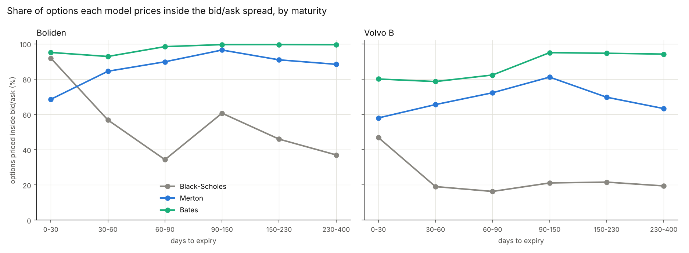
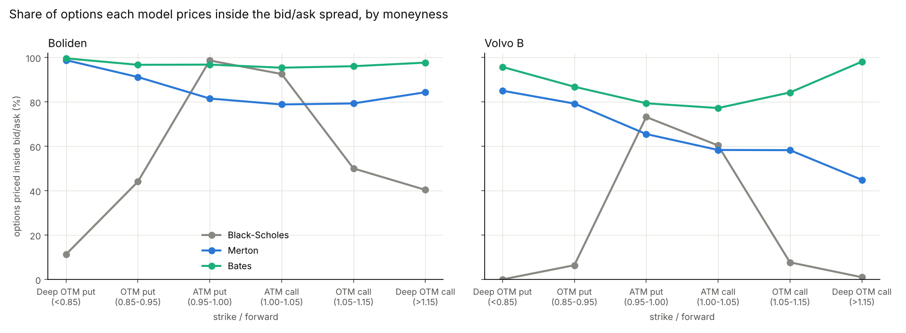
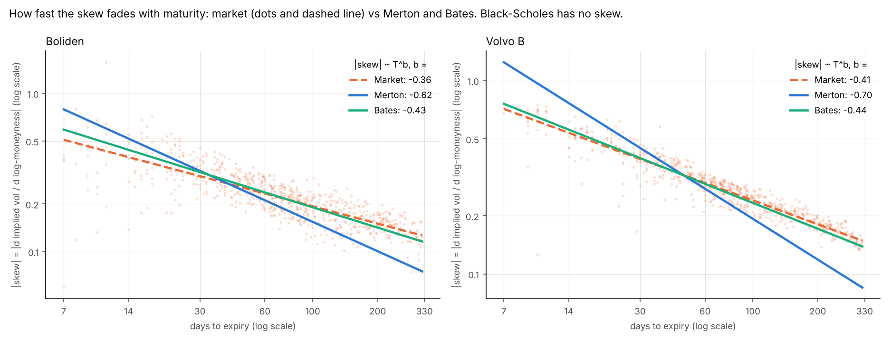
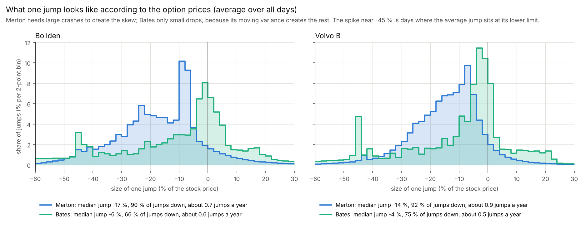
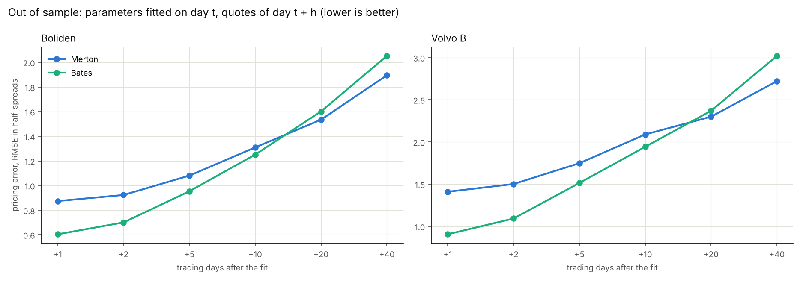

# Fair value of Swedish equity options: Black-Scholes, Merton and Bates

Student project with SEB's equity-derivatives desk (2025-2026). SEB's question:

> Can jump risk improve the pricing of the parts of the option market where Black-Scholes deviates most from market prices?

We price every Boliden (BOL) and Volvo B (VOLVB) option quote from 2 May to 30 Dec 2025 (167 trading days) with three models,
compare the model prices with the market, and test which model still prices well on later days.

## The repository in one picture

```
data/BOL.csv, data/VOLVB.csv    daily closing bid/ask quotes (stock + options)
        |
fair_value.py                    CORE: fair value of every option under Black-Scholes, Merton and Bates
        |                        -> results/fair_values_*.csv, parameters_*.csv, summary tables, 4 charts
out_of_sample.py                 TEST: today's parameters on the quotes 1-40 trading days later, Merton vs Bates
                                 -> results/out_of_sample*.csv, 1 chart
```

## How we measure the market price

- Only closing **bid** and **ask** quotes exist (no trade prices), so the market price is the **mid** = (bid + ask) / 2.
- The true price can be anywhere between bid and ask, so a model price is judged against the spread, not the mid alone.
  The error is measured in **half-spreads**:

  `z = (model price - mid) / ((ask - bid) / 2)`  (half-spread at least 0.05 SEK)

  `|z| <= 1` means the model price is **inside bid/ask**. Fitting on z also gives tightly quoted options more weight.
- Quotes used: out-of-the-money options only (puts with strike below the forward, calls above), bid above 0.01 SEK,
  at least 5 days to expiry, spread no larger than the mid. About 12,000 quotes per stock.
- Inputs: stock price = mid of the stock's bid/ask, interest rate 2 %, no dividend (none in the period). The options are
  American, but without dividends the early-exercise value of out-of-the-money options is below the spread, so European
  pricing is used.

## The three models

| Model | Idea | Parameters per day |
|---|---|---|
| Black-Scholes | constant volatility; here one volatility per expiry | about 4.6 (one per expiry) |
| Merton (1976) | Black-Scholes plus sudden jumps that arrive at random (on average `lam` per year, size ~ normal) | 4: sigma, lam, mu_j, sigma_j |
| Bates (1996) | the variance itself moves randomly and mean-reverts (Heston), plus Merton's jumps | 8: v0, kappa, theta, xi, rho, lam, mu_j, sigma_j |

Merton and Bates are priced with the COS method (Fang & Oosterlee 2008), which turns the model's characteristic function
into option prices. Each model is fitted separately to each day's options (all expiries at once) by least squares on z.

## Results

**1. Fit: share of options priced inside bid/ask** (`results/summary.csv`, all 167 days)

| | Black-Scholes | Merton | Bates |
|---|---|---|---|
| Boliden | 55 % | 86 % | 97 % |
| Volvo B | 24 % | 69 % | 86 % |
| Boliden, RMSE in half-spreads | 1.09 | 0.78 | 0.45 |
| Volvo B, RMSE in half-spreads | 2.05 | 1.27 | 0.70 |



**By moneyness** (`results/summary_by_moneyness.csv`). Options are grouped by strike / forward price (forward = stock price
grown at the 2 % rate until expiry). Only out-of-the-money options are used: puts below the forward, calls above.

| Bucket | Strike / forward | BS Boliden | Merton Boliden | Bates Boliden | BS Volvo B | Merton Volvo B | Bates Volvo B |
|---|---|---|---|---|---|---|---|
| Deep OTM put | below 0.85 | 11 % | 99 % | 100 % | 0 % | 85 % | 96 % |
| OTM put | 0.85-0.95 | 44 % | 91 % | 97 % | 6 % | 79 % | 87 % |
| ATM put | 0.95-1.00 | 99 % | 82 % | 97 % | 73 % | 66 % | 79 % |
| ATM call | 1.00-1.05 | 93 % | 79 % | 95 % | 60 % | 58 % | 77 % |
| OTM call | 1.05-1.15 | 50 % | 79 % | 96 % | 8 % | 58 % | 84 % |
| Deep OTM call | above 1.15 | 40 % | 84 % | 98 % | 1 % | 45 % | 98 % |

Black-Scholes prices the middle and misses both wings (puts too cheap, calls too expensive: the skew). Merton fixes the
crash wing but gives up some accuracy at the money. Bates fits wings and middle at the same time.



**2. Why: the skew across maturities** (`results/skew_decay.csv`). The skew (how much more expensive downside protection is)
fades with maturity like `T^b`. Black-Scholes has no skew at all. Merton's skew fades much too fast, Bates matches the market.

| Exponent b (95 % CI) | Market | Merton | Bates |
|---|---|---|---|
| Boliden | -0.36 [-0.39, -0.33] | -0.62 [-0.66, -0.58] | -0.43 [-0.45, -0.40] |
| Volvo B | -0.41 [-0.42, -0.39] | -0.70 [-0.74, -0.66] | -0.44 [-0.46, -0.43] |



**What the jumps look like** (`results/jump_sizes.csv`). The size of one jump implied by the option prices, averaged over all
days. Merton needs large crashes (median jump -17 % on Boliden, -14 % on Volvo B, about 90 % of jumps downward) to create the
skew. Bates needs only small drops (median -6 % and -4 %), because its moving variance, which tends to rise when the stock
falls, creates the rest of the skew. These are risk-neutral values: they include the price of crash insurance and are not a
forecast of real jumps. On their own, the number of jumps per year and the jump size are poorly determined; their combined
effect (the jump share of variance, about 45 %) is.



**3. Out of sample: is Bates just over-fitting?** (`results/out_of_sample_test.csv`). Parameters fitted on day t price the
quotes of day t + h, which the fit never saw.

| Pricing error h trading days later (RMSE in half-spreads), Merton / Bates | +1 | +5 | +10 | +20 | +40 |
|---|---|---|---|---|---|
| Boliden | 0.87 / 0.60 | 1.08 / 0.95 | 1.31 / 1.25 | 1.53 / 1.60 | 1.89 / 2.05 |
| Volvo B | 1.41 / 0.91 | 1.75 / 1.51 | 2.09 / 1.94 | 2.30 / 2.37 | 2.72 / 3.02 |

Bates is significantly better than Merton (Diebold-Mariano test, p < 0.01) up to 10 trading days ahead on both stocks; at 20
days there is no difference, and at 40 days Merton is better on Boliden. After about 20 days every model is off by more than
a half-spread, so in practice the parameters are re-fitted every day.



**Conclusion.** Jump risk (Merton) fixes most of what Black-Scholes misses, but Merton's skew fades too fast with maturity.
Bates, which adds randomly moving variance, prices 86-97 % of the options inside bid/ask, matches the market's skew across
maturities, and stays better than Merton for about two weeks out of sample.

## How to run

Python 3.10 or newer.

```
pip install -r requirements.txt
python fair_value.py        # about 10 minutes on a 6-core laptop (all days, both stocks)
python out_of_sample.py     # about 1 minute, uses the parameters from fair_value.py
```

`python fair_value.py --max-days 3` is a quick test on the first three trading days; `python fair_value.py --report-only`
redoes only the tables and charts from the saved results (a few seconds).

## Files

| File | Content |
|---|---|
| `fair_value.py` | data loading and filters, Black-Scholes, Merton and Bates pricing (COS), daily fitting, summaries, charts |
| `out_of_sample.py` | the out-of-sample test with the Diebold-Mariano comparison |
| `data/BOL.csv`, `data/VOLVB.csv` | Date, Type (Stock/Option), CallPut, Expiry, Strike, Bid, Ask: closing quotes, no names or account data |
| `results/fair_values_<STOCK>.csv` | one row per option and day: quotes, mid, implied vol, and per model the fair value, z and implied vol |
| `results/parameters_<STOCK>.csv` | Merton and Bates parameters per day, with the day's RMSE and share inside bid/ask |
| `results/summary.csv`, `summary_by_maturity.csv`, `summary_by_moneyness.csv`, `skew_decay.csv`, `jump_sizes.csv` | the tables above |
| `results/fit_by_maturity.png`, `fit_by_moneyness.png`, `skew_decay.png`, `jump_sizes.png` | the charts above |
| `results/out_of_sample.csv`, `out_of_sample_test.csv` | error by horizon and the Merton vs Bates test |

The quotes were provided by SEB for this project. Ask SEB before making the repository public.
